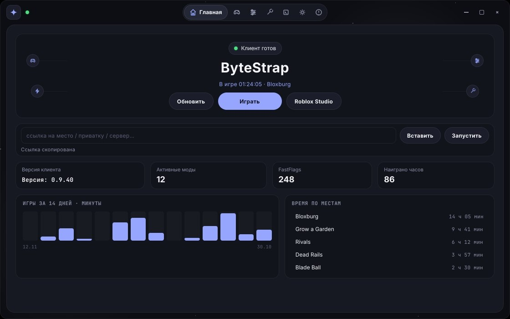
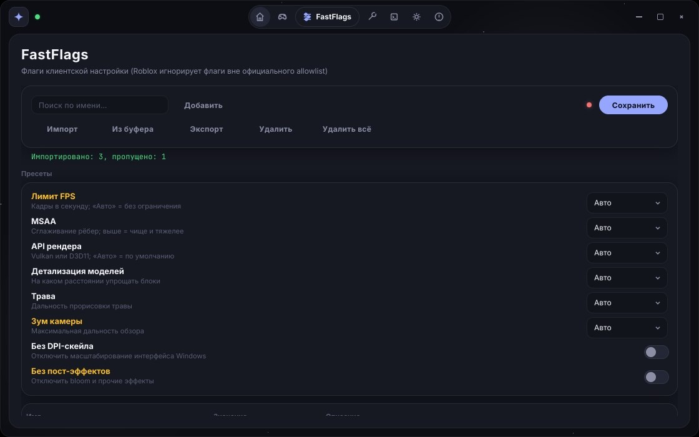

<div align="center">

# ByteStrap

**Лёгкий нативный лаунчер для Roblox на Rust + Slint**

[](https://github.com/mesorg-dev/ByteStrap/releases)
[](https://github.com/mesorg-dev/ByteStrap/releases)
[](https://www.rust-lang.org/)
[](https://slint.dev/)
[](#производительность)

*Никакого Electron, .NET и WebView — один автономный `.exe` с тёмным Material Design 3 интерфейсом, процедурными PvP-модами, редактором FastFlags и минимальным потреблением ресурсов.*

<br>



<br><br>



</div>

---

## Производительность

ByteStrap написан с нуля на Rust с рендером через Slint (FemtoVG) и оптимизирован под слабые ПК и работу в фоне во время игры:

| Показатель | Значение |
| :--- | :--- |
| **Размер файла** | `~17.5 МБ` (один автономный `bytestrap.exe`) |
| **ОЗУ в трее** | `~2.7 МБ` (автоматический сброс рабочего набора памяти) |
| **ОЗУ в открытом окне** | `~28 МБ` |
| **Нагрузка в простое** | `0%` CPU / `0%` GPU |

---

## Возможности

### Процедурные PvP-моды и кастомизация
Лёгкие моды генерируются математически прямо в коде за миллисекунды — без раздувания лаунчера тяжёлыми паками:
- **Текстуры:** `PvP 1×1` (гладкие нейтральные), `FPS Boost` (светлые 1×1) или своя папка текстур.
- **Небо (скайбоксы):** чёрный PvP, ночной космос со звёздами, закат, ясный день или свой набор граней.
- **Прицелы Shift-Lock и курсоры:** точка, тонкий крестик, кольцо или свой `.png`.
- **Шрифты и звуки:** `Inter`, `JetBrains Mono`, `Unbounded`, классический `oof` и подключение локальных файлов.
- **Профили и безопасность:** сохранение пресетов и откат клиента к оригиналам в один клик.

### Редактор FastFlags
- Встроенный каталог популярных флагов с категориями и описаниями на русском и английском языках.
- Быстрая настройка лимита FPS, отключения постобработки, MSAA, дальности прорисовки травы, DPI и других параметров рендера.

### Игры, серверы и пинг
- **Лучшие плейсы:** витрина самых наигранных плейсов с кэшированными обложками, учётом времени и быстрым входом.
- **Честный тест пинга:** параллельный замер чистого TCP RTT по дата-центрам Европы, США, Азии и Австралии.
- **Предпочитаемый регион и уведомления:** всплывающее уведомление с регионом и пингом при подключении к серверу.
- **Галерея скриншотов:** просмотр игровых скриншотов прямо внутри лаунчера.

### Интерфейс и системные фичи
- Тёмный Material Design 3, навигация в стиле Dynamic Island и плавные анимации.
- Оверлей цветовой коррекции поверх Roblox (яркость, насыщенность, контраст).
- Discord Rich Presence, перехват ссылок `roblox://`, переключение каналов клиента, автообновление и сворачивание в трей.
- Полная локализация на русский и английский языки.

---

## Установка

1. Перейдите в раздел [**Releases**](https://github.com/mesorg-dev/ByteStrap/releases) и скачайте последний `bytestrap.exe`.
2. Запустите файл — установка дополнительных библиотек и сред выполнения не требуется.

---

## Сборка из исходников

Потребуется установленный [Rust toolchain](https://rustup.rs/) (stable) под Windows:

```powershell
git clone [https://github.com/mesorg-dev/ByteStrap.git](https://github.com/mesorg-dev/ByteStrap.git)
cd ByteStrap
cargo build --release --locked
```

Готовый бинарник появится по пути `target\release\bytestrap.exe`.

---

## Стек

- **Язык:** Rust
- **UI:** Slint (`renderer-femtovg`, `winit`)
- **Сеть и асинхронность:** `tokio`, `reqwest` (`rustls` + `webpki-roots`)
- **Аудио и архивы:** `rodio`, `zip` (`deflate-flate2-zlib-rs`)

---

## Дисклеймер

ByteStrap — независимый проект с открытым исходным кодом, не связанный с Roblox Corporation. Лаунчер работает только со штатными файлами конфигурации, ресурсами и логами клиента и не модифицирует память игрового процесса.
